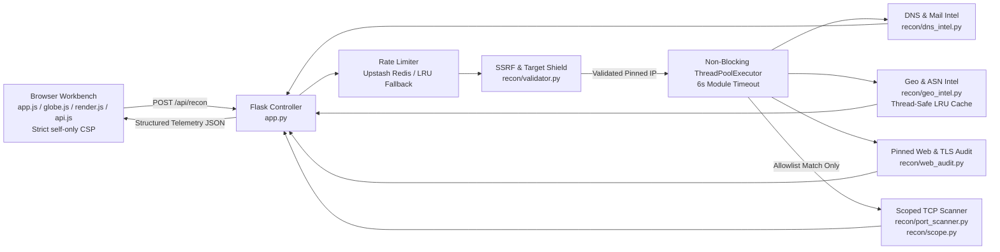

<div align="center">

<h1>NETRECON</h1>

<p><strong>External Attack Surface &amp; 3D Geo Intelligence Workbench</strong></p>

<p>
  Resolve public infrastructure in seconds. Inspect DNS and mail posture, TLS certificate health, weighted HTTP security headers, server disclosures, scoped TCP exposure, and approximate 3D geolocation telemetry from one strict-CSP terminal.
</p>

<p>
  <a href="https://github.com/JoeBuildsThings/NetRecon/actions/workflows/ci.yml">
    
  </a>
  <a href="https://netrecon.vercel.app">
    
  </a>
  
  
  <a href="LICENSE">
    
  </a>
</p>

<p>
  <a href="https://netrecon.vercel.app">Live Workbench</a> &middot;
  <a href="#architecture">Architecture</a> &middot;
  <a href="#capabilities">Capabilities</a> &middot;
  <a href="#security-model">Security Model</a> &middot;
  <a href="#api-reference">API Reference</a> &middot;
  <a href="#quick-start">Quick Start</a>
</p>

</div>

---

## Overview

NetRecon consolidates passive external reconnaissance and operator-scoped active probing into a lightweight web console engineered for predictable security boundaries. Every public domain, URL, or IP target is validated and pinned to a globally routable IP before any outbound probe runs.

The frontend renders a zero-dependency 3D orthographic tracking globe on HTML5 Canvas with bundled vector coastlines, coordinate graticules, animated trajectory arcs, and interactive orbit controls. No third-party CDN scripts, external map tiles, or remote web fonts leave the browser.

---

## Architecture



---

## Capabilities

| Module | Telemetry & Signals |
| :--- | :--- |
| **3D Geo Tracking** | Local HTML5 Canvas orthographic globe with vector coastlines, drag orbit, zoom, pause/reduced motion support, animated arc tracking, ASN, organization, ISP, timezone, and source timestamp. |
| **Web & TLS Posture** | Pinned-socket HTTPS/HTTP probing (including direct public IPv4/IPv6 targets), TLS protocol and cipher suite, CA issuer, certificate expiry countdown, SAN count, weighted 0 to 100 security header grading (`A+` to `F`), server header disclosures, and single-hop redirect SSRF inspection. |
| **DNS & Mail Posture** | Concurrent `A`, `AAAA`, `CNAME`, `MX`, `NS`, `TXT`, `_dmarc`, and reverse `PTR` resolution with DNS/mail provider fingerprinting plus SPF (`-all`, `~all`, `?all`, `+all`) and DMARC enforcement evaluation. |
| **Scoped TCP Exposure** | Concurrent probing across 22 high-signal TCP ports with connection latency, sanitized service banners, risk tiering, and CDN/edge network attribution. |
| **Reporting & Exports** | One-click plain-text executive posture brief (`Copy brief`) and full raw telemetry export (`Export JSON`). |

---

## Security Model

NetRecon treats every submitted target and every remote server response as untrusted input.

| Threat Vector | Implemented Control | Location |
| :--- | :--- | :--- |
| **SSRF & Internal Probing** | Blocks private, loopback, link-local, CGNAT (`100.64.0.0/10`), multicast, reserved, IPv4-mapped IPv6, `.local`, `.internal`, embedded credentials, and non-HTTP/HTTPS schemes. | `recon/validator.py` |
| **DNS Rebinding** | Resolves DNS once upfront and opens raw TLS/HTTP/TCP sockets directly to the validated pinned IP with proper IPv6 bracketed `Host` headers. | `recon/web_audit.py`, `recon/port_scanner.py` |
| **Malicious Redirect Chains** | Single-hop `HEAD` inspection never auto-follows redirects; redirect targets are validated against the SSRF filter and flagged if restricted. | `recon/web_audit.py` |
| **Unauthorized Active Scanning** | Active TCP probing is disabled by default and executes only when the target matches `NETRECON_ACTIVE_SCAN_ALLOWLIST`. | `recon/scope.py`, `app.py` |
| **False Location Plotting** | Missing or failed geolocation lookups return `null` coordinates instead of `(0.0, 0.0)` so the globe never plots a misleading beacon. | `recon/geo_intel.py`, `static/render.js` |
| **Rate & Resource Exhaustion** | 4 KB body cap, 25 requests per 60s window per client IP (optional Upstash Redis shared store), 16 KB response header read cap, and non-blocking thread pool shutdown on timeout. | `app.py`, `recon/web_audit.py` |
| **Client-Side Supply Chain & XSS** | Strict `self`-only Content-Security-Policy (`script-src 'self'`, `style-src 'self'`, `connect-src 'self'`), `X-Frame-Options: DENY`, `nosniff`, and pure `textContent` DOM rendering. | `app.py`, `static/render.js` |

---

## Active Scan Scope Policy

Passive checks (DNS, TLS, HTTP headers, and geolocation) run for every valid public target. Active TCP port probing starts automatically only when the target matches the server-side `NETRECON_ACTIVE_SCAN_ALLOWLIST` environment variable.

Supported allowlist formats:

* **Exact hostnames:** `example.com`
* **Explicit wildcard subdomains:** `*.example.com` (matches subdomains only, not the apex)
* **Public IPs and CIDR ranges:** `203.0.113.10`, `198.51.100.0/24`

See [docs/active-scan-scope.md](docs/active-scan-scope.md) for full scope rules and deployment notes.

---

## API Reference

### `GET /api/health`

Returns service health and current engine version with `Cache-Control: no-store`.

```json
{
  "service": "netrecon",
  "status": "ok",
  "version": "2.2.0"
}
```

### `POST /api/recon`

Runs concurrent passive reconnaissance and, when in scope, active TCP probing against a public target.

```bash
curl -sS -X POST https://netrecon.vercel.app/api/recon \
  -H "Content-Type: application/json" \
  -d '{"target": "cloudflare.com"}'
```

Response top-level keys:

| Key | Description |
| :--- | :--- |
| `ok`, `partial`, `partial_errors` | Overall execution status and any module names that timed out or failed independently. |
| `target` | Canonical `host`, `primary_ip`, `all_ips`, `is_ip`, and raw `input`. |
| `active_scope` | Server-side scope evaluation (`disabled`, `in_scope`, or `out_of_scope`). |
| `geo` | Approximate IP location, `latitude`/`longitude` (or `null`), `asn`, `org`, `isp`, `timezone`, and `source`. |
| `dns` | Resolved record groups, reverse `ptr`, DNS/mail provider attribution, and SPF/DMARC enforcement posture. |
| `web` | Reachability, `status_code`, `grade`, `score`, `tls` certificate telemetry, weighted `headers`, `disclosures`, and `redirect` inspection. |
| `ports` | Active probe status, `edge_cdn`/`edge_provider` detection, `open_ports` list with latency, risk, and banners. |

---

## Quick Start

```bash
git clone https://github.com/JoeBuildsThings/NetRecon.git
cd NetRecon

python3 -m venv .venv
source .venv/bin/activate

pip install -r requirements.txt
python app.py
```

Open `http://127.0.0.1:5000` in your browser.

### Environment Variables

| Variable | Required | Purpose |
| :--- | :--- | :--- |
| `NETRECON_ACTIVE_SCAN_ALLOWLIST` | No | Comma-separated hostnames, explicit wildcards, public IPs, or CIDRs permitted for active TCP probing. |
| `UPSTASH_REDIS_REST_URL` | No | HTTPS endpoint for distributed rate limiting across serverless instances. |
| `UPSTASH_REDIS_REST_TOKEN` | No | Server-side Upstash Bearer token (never expose to client code). |

### Verification & CI Gate

Every push and pull request to `main` enforces four automated checks across Python 3.11 and 3.12:

```bash
pip install -r requirements-dev.txt
ruff check .
mypy recon app.py --ignore-missing-imports
for file in static/*.js; do node --check "$file"; done
pytest tests/ -v --cov=recon --cov=app --cov-report=term-missing --tb=short
```

---

## Repository Layout

```text
NetRecon/
├── .github/workflows/ci.yml
├── app.py
├── vercel.json
├── requirements.txt
├── requirements-dev.txt
├── docs/
│   └── active-scan-scope.md
├── recon/
│   ├── __init__.py
│   ├── dns_intel.py
│   ├── geo_intel.py
│   ├── logger.py
│   ├── port_scanner.py
│   ├── scope.py
│   ├── validator.py
│   └── web_audit.py
├── static/
│   ├── api.js
│   ├── app.js
│   ├── globe.js
│   ├── render.js
│   └── styles.css
├── templates/
│   ├── 404.html
│   ├── 500.html
│   ├── index.html
│   └── privacy.html
└── tests/
    └── test_security.py
```

---

## License & Responsible Use

Released under the [MIT License](LICENSE). Use NetRecon strictly on infrastructure you own or have explicit authorization to assess.
